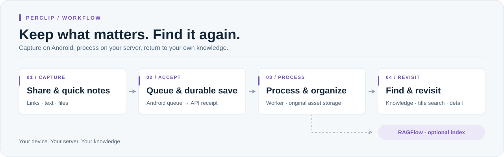
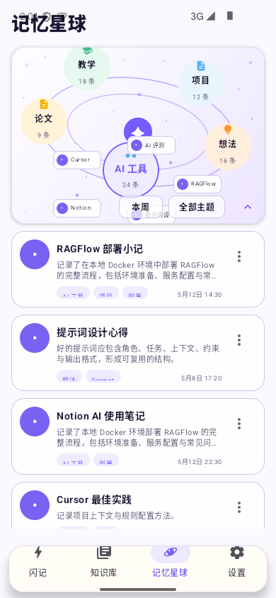
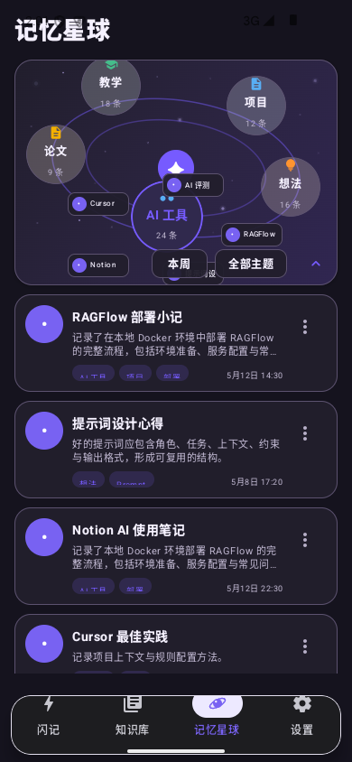
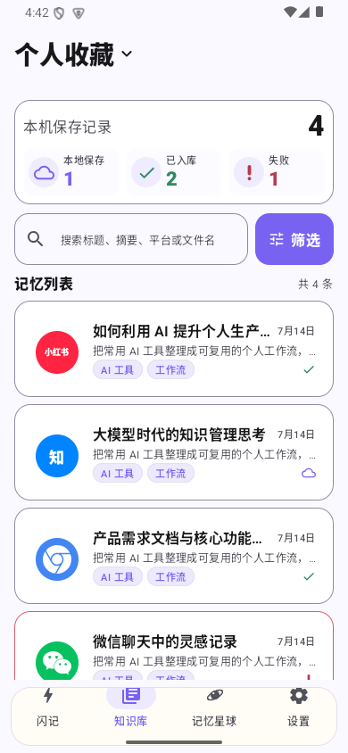
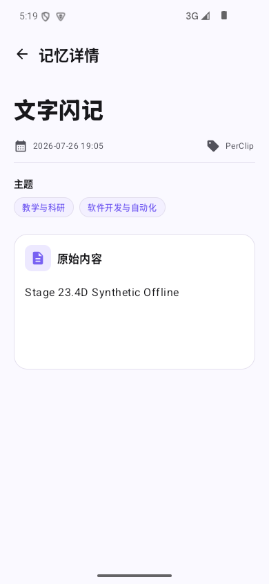
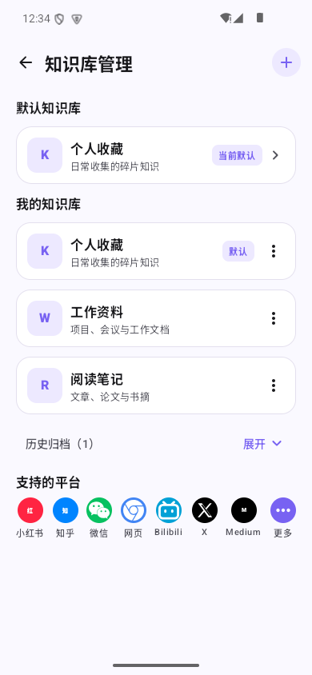

# PerClip

**随手收集，可靠保存，随时找回。**

PerClip 把 Android 上零散的链接、文字与文件，沉淀为自有服务器上的知识资产。
从系统分享和闪记开始，通过持久化队列与后台处理，连接到知识列表、标题搜索和详情，
让收集的内容有去处，也有清晰的找回路径。

[快速开始](#快速开始) · [产品范围](docs/product-scope.md) · [服务端架构](docs/architecture.md) · [环境配置](docs/ENVIRONMENT.md)



## 界面预览

来自 Android App 的离线演示截图；内容均为虚构示例，不包含个人资料或服务器连接信息。

<p align="center">
  
  
</p>
<p align="center"><sub>记忆星球 · 主题轨道、记忆卫星与自然浮现，让收藏变成可以探索的知识空间。</sub></p>

<table>
  <tr><th>知识列表</th><th>记忆详情</th><th>知识库管理</th></tr>
  <tr>
    <td></td>
    <td></td>
    <td></td>
  </tr>
</table>

## 为什么选择 PerClip

| 能力 | 带来的价值 |
| --- | --- |
| **保存可追踪** | Android 本地队列、服务端持久接收与幂等处理，让上传、重试和处理状态有据可查。 |
| **找回更直接** | 知识列表、标题关键词搜索与详情读回，保留原始资产和来源信息。 |
| **数据归自己** | 自托管存储与处理，集成凭据留在服务端；RAGFlow 可按需接入。 |

适合希望将手机内容沉淀到 NAS 或自有服务器的个人与技术用户。
核心保存、列表与标题搜索不依赖 RAGFlow；当前提供 Android 与自托管服务端源码，
不包含托管云服务或正式签名安装包。

## 快速开始

需要 Python 3.11+ 和 [uv](https://docs.astral.sh/uv/)。

```sh
git clone https://github.com/XingjianTian/PerClip.git
cd PerClip
cp .env.example .env
chmod 600 .env
# 在 .env 中设置独立随机 PERCLIP_INGEST_TOKEN，并按需填写地址和路径。
make setup
make api
# 另开终端，在同一目录执行：
make worker
```

在 Android 设置页填入移动端 API 地址和 mobile ingest token；服务端的 RAGFlow、
ASR、embedding 等凭据不进入 APK。默认仅监听回环地址，跨设备访问与可选网关配置
请按 [环境配置](docs/ENVIRONMENT.md) 设置。

## 继续了解

- [服务端说明](server/README.md)：API、Worker、存储与可选集成。
- [数据合同](docs/data-contract.md)：内容、元数据与持久化边界。
- [收集合同](docs/capture-contract.md)：收集入口与客户端职责。

<details>
<summary><strong>开发与验证</strong></summary>

安装 Gitleaks 8.25+、配置 GitHub noreply 邮箱，并为新克隆启用提交前隐私检查：

```sh
make privacy-setup
make test
# Android 构建另需 JDK 17 和对应 Android SDK。
cd android
./gradlew :app:testDebugUnitTest :app:lintDebug :app:assembleDebug
```

测试使用隔离存储与合成语料，不代表真实平台采集或生产部署验收。
提交前请阅读 [隐私检查](docs/PRIVACY.md)；真实配置、个人内容和运行数据应保持在 Git 外。

</details>

**许可说明：**项目自身代码尚未选择开源许可证；第三方组件及合成语料遵循各自许可。
