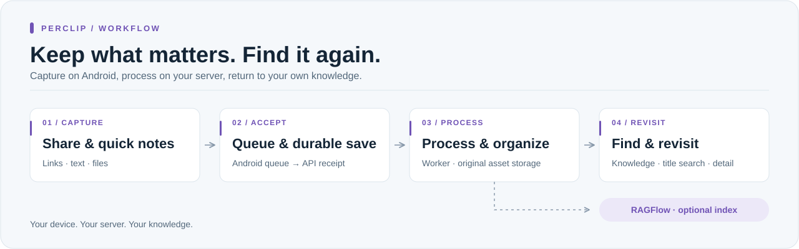
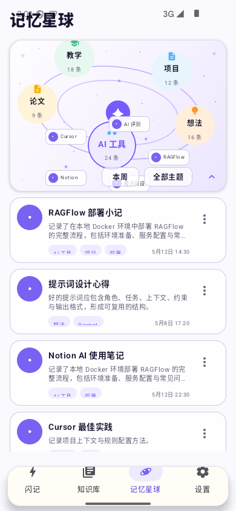
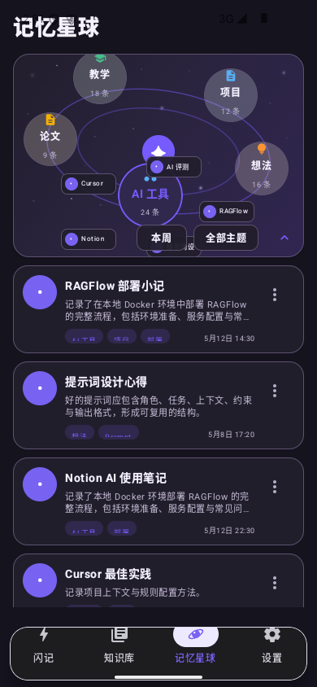
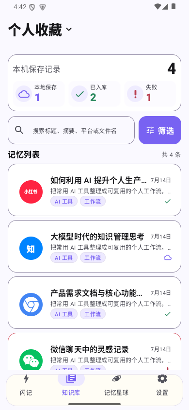
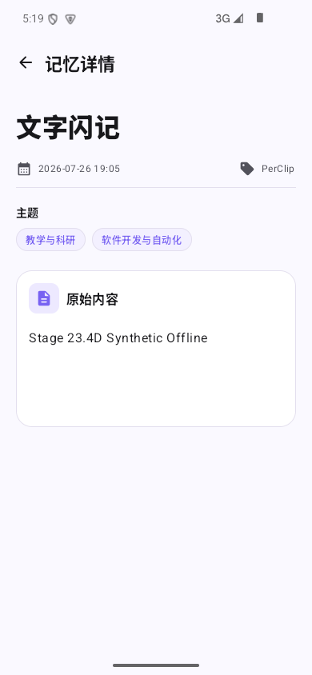
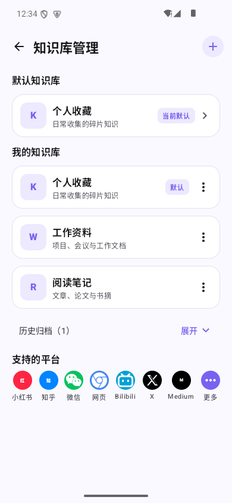

# PerClip

**English (primary)** | [简体中文](README.zh-CN.md)

**Capture easily. Save reliably. Find it again.**

PerClip turns scattered links, text, and files on Android into knowledge assets on your own server.
System sharing and quick notes feed a durable queue and background processing, then connect to a knowledge list, title search, and detail views—giving captured content a home and a clear path back.

[Quick start](#quick-start) · [Product scope](docs/product-scope.md) · [Server architecture](docs/architecture.md) · [Configuration](docs/ENVIRONMENT.md)



## Interface preview

Offline demo captures from the Android app. All content is fictional, with no personal information or server connection settings.

<p align="center">
  
  
</p>
<p align="center"><sub>Memory Planet · Topic orbits, memory satellites, and emerging connections turn saved content into an explorable knowledge space.</sub></p>

<table>
  <tr><th>Knowledge list</th><th>Memory details</th><th>Library management</th></tr>
  <tr>
    <td></td>
    <td></td>
    <td></td>
  </tr>
</table>

## Why PerClip

| Capability | What it gives you |
| --- | --- |
| **Traceable saving** | An Android local queue, durable server acceptance, and idempotent processing make uploads, retries, and processing status traceable. |
| **Direct retrieval** | Browse the knowledge list, search literal title keywords, and read details while retaining original assets and source information. |
| **Your own data** | Self-hosted storage and processing keep integration credentials on the server; add RAGFlow when needed. |

For individuals and technical users who want to collect phone content on a NAS or their own server.
Core saving, lists, and title search do not depend on RAGFlow. The repository currently provides Android and self-hosted server source code, without a hosted cloud service or an officially signed installation package.

## Quick start

Requires Python 3.11+ and [uv](https://docs.astral.sh/uv/).

```sh
git clone https://github.com/XingjianTian/PerClip.git
cd PerClip
cp .env.example .env
chmod 600 .env
# Set an independent random PERCLIP_INGEST_TOKEN and the required addresses and paths in .env.
make setup
make api
# In another terminal, from the same directory:
make worker
```

Enter the mobile API address and mobile ingest token in Android settings. Server credentials for RAGFlow, ASR, embeddings, and other integrations are not included in the APK. The server binds to loopback by default; follow [configuration](docs/ENVIRONMENT.md) for cross-device access and optional gateway setup.

## Explore

- [Server guide](server/README.md): API, worker, storage, and optional integrations.
- [Data contract](docs/data-contract.md): content, metadata, and durability boundaries.
- [Capture contract](docs/capture-contract.md): capture entry points and client responsibilities.

<details>
<summary><strong>Development and verification</strong></summary>

Install Gitleaks 8.25+, configure a GitHub noreply email, and enable pre-commit privacy checks for a new clone:

```sh
make privacy-setup
make test
# Android builds additionally require JDK 17 and the corresponding Android SDK.
cd android
./gradlew :app:testDebugUnitTest :app:lintDebug :app:assembleDebug
```

Tests use isolated storage and synthetic corpora. They do not establish real-platform capture compatibility or production deployment acceptance.
Read the [privacy checks](docs/PRIVACY.md) before contributing; keep real configuration, personal content, and runtime data outside Git.

</details>

**License:** no open-source license has been selected for the project's own code. Third-party components and synthetic corpora retain their respective licenses.
