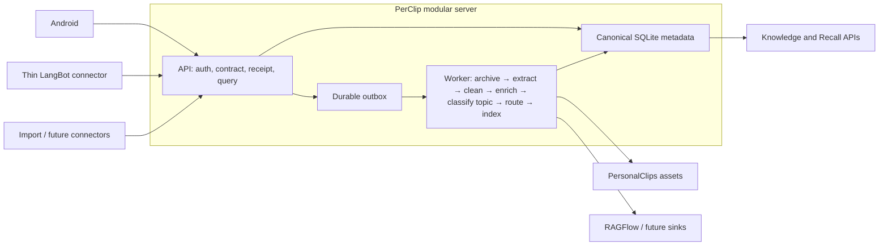

# PerClip architecture

> Current implementation baseline: unified modular server, API + Worker processes.
> The detailed audit and decision record is
> `docs/perclip-service-architecture-audit-review-draft.md`.

## Decision

PerClip is the only data and workflow control plane. Android, LangBot/WeChat,
imports, and future clients are connectors. PersonalClips is the user-owned
asset store. RAGFlow is a replaceable, rebuildable index—not the source of
truth.

The server remains a modular monolith and is deployed as two processes:

- `perclip-api`: authentication, transport mapping, contracts, idempotency,
  receipts, queries, and durable acceptance;
- `perclip-worker`: archive, extract, clean, enrich, classify topic, route, and index.

SQLite WAL, a persistent outbox, and one Worker are appropriate for the
current single-user NAS deployment. Redis, Celery, Kubernetes, and multiple
business implementations are intentionally excluded.



## Ownership

| Concern | Owner |
| --- | --- |
| Immutable memory identity | PerClip `clip_identities.public_id` |
| Source event and idempotency | PerClip `source_events` and `ingest_receipts` |
| Original and derived bytes | PersonalClips, described by PerClip `assets` |
| Processing state and lineage | PerClip `outbox_jobs` and `processing_runs` |
| Knowledge Base association | PerClip `clip_knowledge_bases` and route decisions |
| Search/vector intent and attempts | PerClip `index_attempts`; remote RAGFlow content is rebuildable |
| Verified serving pointer | PerClip `active_indexes`; changed only after remote evidence |
| Recall state | PerClip `recall_*`, independent of RAGFlow availability |

The compatibility `clips.ragflow_document_id` and `index_documents` fields
remain for older API and migration behavior. New indexing intent uses a unique
operation key over:

```text
provider + dataset + public clip + public generation + content hash + contract version
```

One memory can therefore belong to more than one Knowledge Base and can later
be indexed by more than one provider.

## Ingest and processing

`perclip.ingest.v1` is the canonical connector contract. Production Worker
mode validates and persists the compatible clip, normalized metadata, source
identity, staged asset description, Knowledge Base intent when supplied, and
first outbox job, then returns `202 Accepted`. If the process exits between the
compatibility-store commit and pipeline registration, Worker startup
reconciles accepted clips missing a durable identity/job.

The versioned pipeline is:

```text
accepted
→ archive_original
→ extract
→ clean
→ enrich
→ route
→ index
→ ready
```

Manual Knowledge Base intent is fixed during acceptance. Automatic routing is
performed by the Worker after extraction and cleaning. Each stage is
idempotent on `(clip_id, stage, engine_version, input_hash)`, is lease-owned,
records bounded safe errors, and either retries with backoff or terminates
without erasing the accepted memory. A completed stage and its next outbox job
are committed together.

The Worker claims exactly one job immediately before execution and renews that
lease with a heartbeat while the stage is running. Later jobs in a requested
batch therefore remain pending rather than aging under an unstarted lease. A
stale token cannot renew, fail, or complete a lease now owned by another
Worker.

`clean_markdown`, then `extracted_text`, then raw clip content form an explicit
enrichment input projection. Extractor title, safe normalized request,
resolved/document-canonical URL, redirect summary, optional author/publish
time/language, quality state/reason,
safe error, fallback usage and Recall eligibility are versioned asset metadata.
Structured fields include source, engine/version, input/output hashes,
confidence and reason. Normalized metadata retains latest attempted, latest
successful usable, and active projections plus the active enrichment pointer.
Completed or usable-partial attempts advance active state. A failed or raw-
fallback attempt remains visible operationally but cannot replace an existing
usable active projection.

`ActiveContentResolver` is the sole domain resolver for Knowledge, Recall,
quality, overview, domain, and resurfacing reads. It selects
`processing.active_enrichment_id`; pointer-less legacy rows alone may fall back
to the latest completed enrichment. A present pointer that is missing or points
to another clip is diagnosed as `invalid_active_pointer`; it never silently
falls back to an older enrichment. This keeps Knowledge and Recall on the same
successful content when a later attempt is unusable, while a later usable retry
advances both through the active pointer.

The mobile read contract is `perclip.quality-read.v1`. It keeps user status
(`saved`, `processing`, `ready`, `needs_attention`) separate from content
quality, pipeline jobs, and index state. `GET /api/clips/{clip_id}/quality`
returns the full privacy-audited model; `GET
/api/knowledge-bases/{knowledge_base_id}/clips` returns its compact projection.
Both numeric compatibility lookup and `pc_…` lookup return the same stable
public `clip_id`; neither response serializes the SQLite row ID. Recall uses
that same identity in details, highlights, sessions, resurfacing, weekly reads,
graph memory IDs, and interaction targets while retaining the numeric Clip key
only inside persistence and statistics. Knowledge pagination is a live keyset
read, not a frozen snapshot: it accepts only a scope-bound persisted `kc_…`
cursor, returns `next_cursor`, expires cursors after 24 hours, and removes
expired rows without invalidating live cursors. Processing and index references
are stable clip-bound `gen_…` display tokens, not enrichment, asset, or
projection identifiers.

Only active `archive_original`, `extract`, `clean`, `enrich`,
`classify_topic`, or `route` work
drives user-visible `processing`; `index` is independent and cannot hide ready
content. An active reprocess reports `in_progress` and a safe `current_stage`
while retaining the prior usable title, summary, text, and URL. Recall consumes
the same resolved content. Ordinary mobile responses preserve compatibility
keys but do not expose storage paths, captured sensitive URLs,
Dataset/Document IDs, connector credentials, stacks, secret-like values, or
macOS/Linux/Windows/UNC/file/SMB private paths. Absolute POSIX roots covered by
the shared redactor are `/Users`, `/home`, `/mnt`, `/nas`, Synology-style
`/volumeN`, `/Volumes`, `/opt`, `/srv`, `/var/lib`, `/root`, `/app`, `/data`,
and `/tmp`; relative/code paths and path-like HTTP(S) URLs remain intact.
Operator-only RAGFlow dry-run
and sync surfaces retain Dataset mapping diagnostics and remain separate from
this mobile contract.

An explicit user title and Knowledge Base are authoritative. Automatic title
selection then uses JSON-LD headline, Open Graph title, HTML title, `h1`, and a
safe content fallback. Processing status and safe-error text are never content
titles. Failed and unusable partial projections route to Inbox when no manual
target exists and are excluded from Recall; usable partial content may remain
eligible. The detailed contract is
`quality/structured-quality-semantics.md` (historical reference retained in the private archive).

The current SQLite boundary cannot make the existing compatibility
`ClipStore.save` and pipeline registration literally one SQL transaction
without breaking the stable Android/receipt layer. Startup reconciliation is
the implemented crash-safety bridge. A future schema consolidation may remove
that boundary without changing the public contract.

The recovery contract is explicit rather than implied:

| Interruption point | Durable evidence | Recovery rule |
| --- | --- | --- |
| After compatibility acceptance, before pipeline registration | Accepted `clips` row and receipt | Worker startup registers only accepted clips missing canonical identity/job state; replay is idempotent. |
| While a stage is running | Token-owned `running` job, processing run, and lease expiry | The active Worker heartbeats; after expiry another Worker may reclaim, while the stale token cannot renew, fail, or complete. |
| Between a stage result and its successor | Stage output and successor enqueue share one pipeline-store transaction | Commit both or neither; an idempotent replay observes the completed stage and does not duplicate the successor. |
| During an operator retry or dry-run promotion | Immutable `pipeline_control_events` keyed by request ID | Exact confirmation is required; replay returns the recorded result and never replaces a running lease. |

Startup reconciliation repairs only the first boundary. It does not reinterpret
terminal failures, promote `planned` indexes, call RAGFlow, or hide missing
assets; those remain explicit audited operator decisions.

## Connectors and credentials

The Android client uses the primary ingest credential. Every non-Android
connector can have a distinct adapter-scoped credential. Connector credentials
can call only strict ingest endpoints for their mapped adapter; they cannot
read Knowledge, Recall, or administration APIs.

The framework-neutral WeChat bridge owns event normalization, bounded media
transfer, and its local delivery outbox. A real LangBot integration must
implement only the version-specific event/reply/media ports. It must not own
NAS paths, RAGFlow credentials, cleaning, routing, or indexing. A concrete
callback remains unverified until the deployed LangBot SDK version is supplied
and contract-tested.

## Extraction and safety

Worker-owned extraction includes text, URL, PDF, DOCX, XLSX, PPTX, and
format-scoped safe fallback handling. Original assets are retained separately
from derived text and cleaned Markdown. Generic unknown binary data is never
treated as text merely because it contains printable runs. Engines and versions
are recorded on every asset.

URL fetch rules are mandatory:

- HTTP/HTTPS only, with userinfo rejected;
- DNS resolution must contain only public addresses;
- the connection is pinned to a validated address while TLS uses the original
  hostname;
- every redirect is resolved and validated again;
- redirect, response-size, timeout, and MIME budgets are bounded;
- fragments and known tracking parameters are removed from canonical URLs;
- the captured URL remains in the protected raw record; ordinary normalized
  metadata contains only scrubbed request/resolved/document-canonical/display
  URLs and an original-URL SHA-256;
- HTML canonical metadata is never fetched automatically, rejects userinfo,
  localhost, internal hostnames and non-public literal IPs, and records source
  host, canonical host, cross-origin status, provenance and validation result;
- article/main content is preferred and navigation/footer noise is removed;
- state is content-based: a short usable body may be `completed`; `partial`
  requires a clear incompleteness reason; security/MIME/oversize/unknown-binary
  rejection or no usable body is `failed`;
- production loopback/private-address blocking remains fail-closed and test
  response plans do not add a production bypass.

Authenticated/dynamic websites and provider-specific extractors are not
silently simulated. They remain explicit future extension points.

## RAGFlow boundary

RAGFlow environment mode defaults to `off`; `index` is the asynchronous index
sink and `qa` is capability-only. Off and qa modes make no index HTTP call.
Index mode without both real-sync gates persists a `planned` intent and does
not call the adapter. Real synchronization requires the existing multi-gate
configuration and must never run together with the legacy
ClipToRAGFlow archiver. Index failure does not roll back asset archival or make
Recall unavailable. Core becomes ready after route; index success is not a
readiness prerequisite. Detaching a memory from a Knowledge Base immediately
removes its active serving pointer and marks its attempt/reference
`detached_pending_cleanup`; remote deletion is a separate, auditable operation.

Every active projection publishes `index_eligible` and `index_reason`.
Completed and usable-partial projections may create an index intent; failed,
raw-fallback, unsupported-binary and security-blocked projections cannot. The
Worker checks the active projection and exact clean-asset pointer before any
adapter call. Ineligible work records `skipped_quality_gate`, retains the clip,
asset, route and Knowledge Base association, and creates no synthetic index
document. A failed reprocess never replaces an older successful index; only a
later usable projection schedules new content.

Index processing records durable serving state as `active_index` separately
from the operational `latest_index_attempt`. Failed, partial-unusable, and
`no_new_eligible_projection` attempts update only the latter and preserve a
previously usable active index. A first attempt without a dataset mapping has
no real active index and records `skipped_no_dataset_mapping`; adding the
mapping and explicitly reassociating the Knowledge Base schedules a later
index attempt.

A dry-run `planned` reference is deliberately eligible for a guarded real-sync
promotion; it is not equivalent to `indexed_verified`. Upload, metadata update,
parse request, polling, complete paginated Chunk evidence, and vector evidence
are separate stages. RAGFlow v0.26.1's public API strips vector fields and
`available` is not vector evidence, so the ordinary HTTP adapter reports that
capability as unsupported. Only remote `done`, non-zero Chunks, exact
vector-count-equals-Chunk-count evidence from an explicit verifier, and full
matching intent metadata can atomically replace `active_indexes`. Terminal failed jobs can be
reopened only through the confirmation-gated internal CLI. Both actions use
idempotent operator request IDs and append `pipeline_control_events` containing
the previous status, attempt count, and safe error. They refuse to replace a
running lease. Retries recover by the deterministic operation key and refuse
ambiguous remote matches. Full lifecycle, metadata, cleanup, and preflight
details are in RAGFlow Index Correctness (historical reference retained in the private archive).

## Extension model

Only four extension categories are supported:

- Connector: capture transport and source normalization;
- Extractor: URL, file, media, or platform-specific content extraction;
- Enricher: OCR, ASR, summaries, tags, entities, or graph projection;
- Sink: RAGFlow, another index, publishing, or backup.

Provider code receives bounded context and returns versioned results. It does
not create parallel clip databases or redefine identity, routing, receipts, or
processing state. PostgreSQL, object storage, tenants, quotas, audit logs, and
multiple Workers can later replace infrastructure adapters while preserving
these domain contracts.

## Legacy transition

ClipToRAGFlow is rollback/read-only compatibility only. Its useful file
extraction, deterministic cleaning, and RAGFlow practices have been migrated
into PerClip-owned, tested modules. Production must not dual-write through both
systems.

The guarded importer performs a read-only audit by default. Apply mode requires
an explicit confirmation phrase, a destination backup, and a Dataset mapping;
it never writes the old database or RAGFlow. See
`docs/legacy-cliptoragflow-migration.md`.

## Verified and unverified boundaries

Locally verified: contracts, adapter-scoped authentication, receipts,
pipeline leases/retry/recovery, staged/original/derived assets, safe URL and
file extraction, automatic/manual routing, multi-KB indexing metadata,
read-only audits, guarded legacy import, and framework-neutral WeChat bridge.

Not yet verified: the deployed LangBot SDK callback, live WeChat media,
content-level reconciliation of the historical data set, real NAS migration,
real RAGFlow rebuild/cleanup, OCR/ASR/LLM providers, and production cutover.
Those operations require the migration gates and must not be reported as
successful from local tests.
